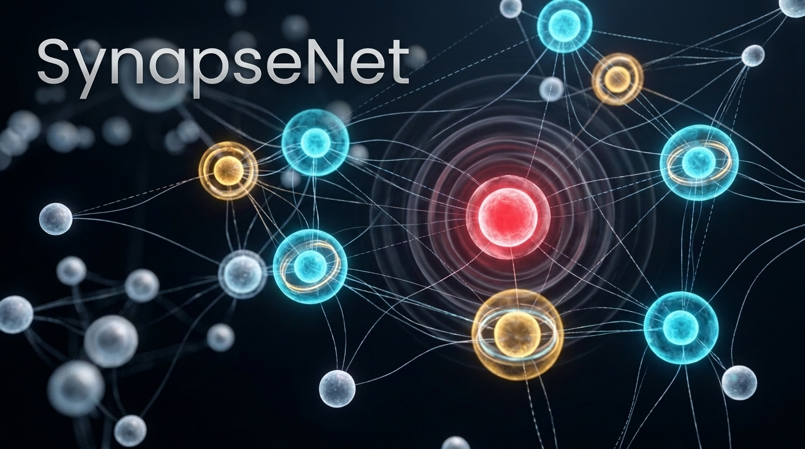

# SynapseNet — architettura del sistema



Un modello linguistico grande di solito gira su una sola GPU, oppure su un gruppo di GPU collegate fra loro con interconnessioni dedicate, **in un data center**. SynapseNet segue un'altra strada: divide il modello su schede con quantità di VRAM diverse — anche schede da 8 GB, o più capienti — collegate da una rete ordinaria, senza cavi speciali e senza stare nella stessa stanza.

Il documento descrive **come è fatto il sistema**: i quattro livelli, gli strumenti, i protocolli, gli adattamenti al motore, le regole di taglio e i limiti. L'architettura è spiegata su un solo modello, `Qwen 3.8 27B`; altri modelli compaiono nella sezione finale, come casi su cui il sistema è stato provato.

---

## Indice

1. [Il problema](#1-il-problema)
2. [Il modello di riferimento: Qwen 3.8 27B](#2-il-modello-di-riferimento-qwen-38-27b)
3. [L'architettura: i quattro livelli](#3-larchitettura-i-quattro-livelli)
4. [Strumenti e tecnologie](#4-strumenti-e-tecnologie)
5. [I protocolli](#5-i-protocolli)
6. [Adattamenti al motore di inferenza](#6-adattamenti-al-motore-di-inferenza)
7. [Come si decide il taglio](#7-come-si-decide-il-taglio)
8. [Rete, NAT e resilienza](#8-rete-nat-e-resilienza)
9. [La protezione del testo](#9-la-protezione-del-testo)
10. [Comportamento del sistema](#10-comportamento-del-sistema)
11. [Dove sono stati fatti i test e cosa hanno mostrato](#11-dove-sono-stati-fatti-i-test-e-cosa-hanno-mostrato)

---

## 1. Il problema

### Il modello a volte ci sta, a volte no

Il ragionamento ovvio è «il modello è troppo grande, non ci sta nella GPU». È vero per i modelli più grandi, ma non è l'unico caso.

In quantizzazione a 4 bit un modello da 27 miliardi di parametri sta comodamente in una scheda da 24 GB. Eppure, anche lì, quello che non ci sta è tutto il resto: la memoria che cresce con la lunghezza della conversazione (la KV cache), il pezzo che serve a leggere le immagini, la piccola testa che accelera la generazione (MTP).

Alla finestra piena di 262.144 token, la sola KV cache di `Qwen 3.8 27B` vale circa **16 GB**. Sommata ai pesi, una GPU da 24 GB non ce la fa. Due sì.

Con modelli più grandi, invece, sono i pesi stessi a non entrare in una sola scheda: va diviso il modello anche a conversazione corta.

Ci sono quindi due motivi per distribuire il calcolo: **i pesi che non entrano**, e **la memoria che cresce mentre l'utente parla**. La stessa catena di GPU affronta entrambi; cambia solo il taglio che conviene scegliere.

### Il secondo problema: la riservatezza dei dati sulla GPU remota

Quando il calcolo viene distribuito su schede esterne, c'è un aspetto fondamentale: **per elaborare una risposta, la GPU remota riceve e manipola gli stati intermedi del modello direttamente nella propria memoria**.

Chi ha provato a distribuire i modelli su più computer si è spesso affidato a una convinzione intuitiva ma errata:
*«Alla scheda grafica remota non inviamo le parole scritte dall'utente, ma solo una serie di numeri (i vettori degli strati intermedi), quindi chi ospita quella scheda non può sapere cosa stiamo chiedendo.»*

La ricerca ha mostrato che questa convinzione **è falsa**, su due piani diversi:

1. **Sul percorso di rete**: nei sistemi RPC tradizionali i tensori viaggiano su connessioni non cifrate, esposte a chiunque si trovi in mezzo.
2. **Dentro la GPU remota**: anche proteggendo il canale di rete con un tunnel cifrato, chi possiede la scheda vede comunque gli stati intermedi nella propria memoria. **Logit-Lens** (*nostalgebraist*, 2020) e la **Tuned Lens** (Belrose et al., 2023) hanno mostrato che i vettori degli strati intermedi sono già parzialmente allineati con lo spazio del vocabolario finale: moltiplicandoli per la tabella pubblica delle parole del modello si possono ricostruire con buona approssimazione singoli token. Gli stessi autori di **Petals** lo segnalavano nella loro documentazione: il trasporto era cifrato, ma il nodo che ospitava i layer poteva potenzialmente risalire al testo dell'utente.

La crittografia omomorfica applicata a ogni token non è stata provata in questo sistema; la strada seguita, descritta nella [sezione 9](#9-la-protezione-del-testo), si limita ad applicare quanto proposto dagli studi sull'invarianza computazionale e sull'offuscazione covariante (*SliceGPT*, *QuaRot*, *AloePri*, *ConjFormer*): la validità matematica e l'efficacia di queste trasformazioni sono interamente a carico della letteratura scientifica citata.

### Le domande da cui sono partito

Non sono partito da una soluzione, ma da cinque domande. Le scrivo come mi si sono presentate, perché il resto del documento è il tentativo di rispondere alle prime quattro — non la prova che la quinta abbia una risposta.

1. **Il modello può essere diviso?** Non «in quanti pezzi», ma proprio se un modello pensato per girare intero su una macchina possa essere tagliato e continuare a funzionare su macchine diverse.
2. **I prompt e le informazioni possono essere offuscati per non farli leggere?** Proteggere la connessione di rete non basta: chi esegue il calcolo vede i vettori intermedi nella propria memoria. La domanda riguarda la protezione dei dati *mentre vengono elaborati*, non solo mentre viaggiano.
3. **È possibile farlo in peer-to-peer?** Senza un server centrale che tenga il modello, con nodi che entrano ed escono e con router domestici in mezzo.
4. **Se il modello viene diviso, il taglio deve essere adattato a ogni LLM diverso?** Gli strati non sono tutti uguali e non fanno tutti lo stesso lavoro. La risposta che questo documento dà è **sì**: serve un profilo per architettura, con regole e pesi diversi per ciascun modello.
5. **Tutti gli LLM possono essere adattati?** Questa **resta aperta**. Sono stati provati tre modelli diversi, ma questo non dice ancora quali architetture siano compatibili e quali no: il sistema descrive dei casi, non una regola generale.

Le prime quattro sono architettura. La quinta resta aperta.

---

## 2. Il modello di riferimento: Qwen 3.8 27B

Il punto che cambia tutto è che **gli strati non sono tutti uguali**. Fino a pochi anni fa un modello da 64 strati era 64 copie dello stesso blocco: stesso peso, stesso lavoro. Tagliare al 30 o al 32 non faceva differenza. Con i modelli ibridi non è più così.

| Cosa | Valore |
|---|---|
| Strati del tronco | 64, cioè 16 volte il ciclo **3 Gated DeltaNet + 1 attenzione completa** (`full_attention_interval: 4`) |
| Strati che accumulano KV cache | **16 soltanto** (quelli di attenzione completa: `blk.3`, `7`, `11` … `63`) |
| Strati a stato fisso | 48 Gated DeltaNet: tengono la storia in uno stato ricorrente che non cresce con la conversazione (~1,5 MB per strato in BF16) |
| KV cache | ~64 KB per token in FP16 → circa **16 GB** a 262.144 token |
| Vettore che passa fra strati | 5.120 numeri = **circa 10 KB** in FP16 |
| Peso degli strati in una build a 4 bit | da ~172 MB (`blk.14`) a ~269 MB (`blk.63`): **non costante** |
| Testa MTP in coda | `blk.64`, ~335 MB |
| Vocabolario + classificatore | `token_embd.weight` + `output.weight`, circa 1,68 GB in coppia |

Dividere «32 strati e 32 strati» non divide la memoria a metà. Non è un errore di calcolo — il confine fra due strati è sempre valido — ma è un errore di **bilanciamento**, e diventa più grave con l'uso, perché la memoria della conversazione si concentra su pochi strati.

---

## 3. L'architettura: i quattro livelli

Il sistema è separato in quattro livelli. I primi due non eseguono il modello: uno raccoglie le richieste, l'altro decide. Il calcolo sta tutto negli ultimi due, che parlano direttamente fra loro.

```
┌───────────────────────────────────────────────────────────────────────────────────┐
│ LIVELLO 1 · CLIENT E DASHBOARD                                                    │
│ • Dashboard web (Next.js / React) · qualsiasi client OpenAI-compatible            │
│   (Cursor, OpenWebUI, SDK Python/JS)                                              │
└─────────────────────────────────┬─────────────────────────────────────────────────┘
                                  │ HTTP/1.1 · REST JSON + SSE (streaming)
                                  │ Autenticazione: OAuth 2.0 (Google) + JWT
                                  ▼
┌───────────────────────────────────────────────────────────────────────────────────┐
│ LIVELLO 2 · CONTROL PLANE E ORCHESTRATORE   (solo CPU · nessun peso sul server)  │
│ • Spring Boot / Java + PostgreSQL + migrazioni Flyway                             │
│     - Registro della flotta e heartbeat: stato GPU, VRAM, banda, consumo, RTT    │
│     - Motore water-filling e modello di costo: taglio degli strati e contesto max │
│ • Gateway Rust in modalità proxy, senza pesi: inoltra JSON/SSE al nodo Master    │
│   attraverso un tunnel cifrato, anche se il Master è dietro NAT                  │
└───────────────────┬───────────────────────────────────────────┬───────────────────┘
                    │ Coordinate del rig e range di strati        │ Tunnel HTTP su QUIC
                    ▼                                             ▼
┌─────────────────────────────────────────┐  ┌───────────────────────────────────────┐
│ LIVELLO 3 · NODO GPU MASTER (STAGE 0)   │  │ LIVELLO 4 · NODI GPU WORKER (STAGE 1+)│
│ • Demone Rust                            │  │ • Demone Rust                          │
│ • llama-server (Master-on-GPU)           │  │ • Backend RPC locale                   │
│ • Backend RPC locale                     │  │ • Solo i propri strati, prelevati con  │
│ • Sparse GGUF: intestazione, vocabolario│  │   richieste HTTP Range                 │
│   e classificatore, tutto il resto come │  │ • Pesi trasformati per la protezione   │
│   riferimenti ai pesi                    │  │   del testo                            │
│ • token_embd + output + blk.64 (MTP)    │  └───────────────────▲───────────────────┘
│   pinnati con -ot                       │                      │
└─────────────────────┬───────────────────┴──────────────────────┘
                      │  Data plane diretto GPU ↔ GPU (il relay non è nel percorso
                      │  dei tensori): QUIC + TLS 1.3 con identità Ed25519,
                      │  hole-punching UDP diretto, canali ALPN dedicati
                      │
       4a. Andata ────┴──────────────────────────────────►  1 vettore ≈ 10 KB/token
       4b. Ritorno ──────────────────────────────────────◄  un solo hop per logit e MTP
```

| Livello | Ruolo |
|---|---|
| **1 · Client** | Presenta la dashboard e accetta richieste in formato OpenAI. È l'unico punto di ingresso pubblico. |
| **2 · Control plane** | Tiene lo stato della flotta, decide il taglio e assegna i compiti. Non ha GPU, non ha pesi, non vede tensori. Il suo gateway raggiunge il Master in tunnel, così non serve che il Master sia esposto su Internet. |
| **3 · Master (Stage 0)** | Esegue i primi strati, possiede il vocabolario e il classificatore, e chiude il calcolo. Tiene con sé anche la testa MTP. |
| **4 · Worker (Stage 1+)** | Esegue gli strati di coda. Scarica e conserva solo i propri pesi. |

### Il file sparso

Sul Master esiste un file GGUF delle stesse dimensioni virtuali del modello, ma che occupa fisicamente solo l'intestazione, il vocabolario e il classificatore. Al posto di ogni altro tensore c'è un piccolo riferimento. Quando il motore chiede un peso, il nodo che lo possiede risolve quel riferimento nella propria cache locale. Nessuno deve scaricare il modello intero, e sul control plane non transita un byte di pesi.

---

## 4. Strumenti e tecnologie

| Componente | Linguaggio / stack | Ruolo |
|---|---|---|
| Data plane e agente dei nodi | Rust | Collegamenti QUIC P2P, STUN e scoperta dell'indirizzo, hole-punching UDP, runtime asincrono per i ponti TCP ↔ QUIC, server HTTP locale, client HTTP Range, crittografia Ed25519 e TLS 1.3, generazione delle trasformazioni, telemetria NVML |
| Motore di inferenza e kernel GPU | C++ / CUDA | Motore basato su `llama.cpp` (`llama-server` + backend RPC), con supporto alla divisione per strati anche quando alcuni tensori sono pinnati, al decoding speculativo MTP, e kernel nativi per l'attenzione GQA e per i blocchi lineari Gated DeltaNet |
| Control plane e orchestratore | Java 21 / Spring Boot 3 | API REST, filtro JWT, persistenza della flotta con JPA/Hibernate e Flyway, stato del cluster su PostgreSQL 16 |
| Dashboard e playground | TypeScript / Next.js 16 (React 19) | Interfaccia, visualizzatore della topologia in tempo reale: rig, range di strati per GPU, VRAM occupata e libera, RTT del collegamento diretto, fase di avvio, chat in streaming con separazione del ragionamento |
| Catalogo delle policy | JSON dichiarativo | Un `policy.json` per architettura: qui `qwen3.8-27b`. Dichiara l'allineamento dei gruppi di strati (`layer_group_alignment: 4`), la posizione della testa MTP, la riserva di VRAM per lo Stage 0 e i parametri di campionamento |
| Distribuzione | Docker + NVIDIA Container Toolkit | Immagini multi-architettura con passthrough GPU, su Linux nativo e su Windows tramite WSL2 / Docker Desktop |

La telemetria hardware legge in tempo reale VRAM libera, banda di memoria, consumo, temperatura e ritardo di rete. Non serve a dichiarare potenza: serve a decidere il taglio.

---

## 5. I protocolli

### Rete e attraversamento del NAT

| Protocollo | Cosa fa |
|---|---|
| **QUIC v1 su UDP** | Sostituisce il TCP fra le GPU per evitare il blocco *head-of-line* e gli handshake ripetuti a ogni passo di decodifica. Una sola connessione UDP persistente, con stream bidirezionali multiplexati: non si riapre la connessione a ogni token. |
| **TLS 1.3 con identità Ed25519** | Ogni nodo ha una coppia di chiavi proprie e un identificatore derivato dalla chiave pubblica. L'autenticazione non richiede certificati DNS né autorità di certificazione esterne. |
| **Canali ALPN dedicati** | Tre canali separati sulla stessa connessione: `synapsenet/ggml-rpc/1` per il protocollo binario dei tensori e dei grafi di calcolo, `synapsenet/http-proxy/1` per il tunnel inverso che porta le richieste `/v1/chat/completions` al Master dietro NAT, `synapsenet/shard/1` per metadati e frammenti del modello. |
| **Hole-punching UDP inverso** | STUN e la scoperta dell'indirizzo via QUIC rilevano l'indirizzo e la porta UDP pubblici assegnati dal router. Uno scambio simmetrico di pacchetti UDP fuori banda apre il canale su entrambi i lati e porta il collegamento da relay a diretto. |
| **Sessione resiliente** | Se una VPN cade o un link salta durante la generazione, un livello di sessione con buffer di riallineamento riprende il flusso dal byte esatto, senza far cadere il motore di inferenza. |

### Calcolo distribuito e pesi

| Meccanismo | Cosa fa |
|---|---|
| **Protocollo binario RPC** | Su socket locale, il motore invia comandi di allocazione, caricamento pesi ed esecuzione dei sottografi CUDA. |
| **Riferimenti ai tensori** | Il file sparso del Master contiene riferimenti invece dei pesi. Il ponte Rust li traduce al volo nell'identificatore reale del peso presente nella cache del nodo che lo possiede. |
| **Sparse GGUF** | File delle dimensioni virtuali del modello, con un buco a zero byte per ogni tensore remoto e un piccolo tag al suo posto. Intestazione, vocabolario e classificatore sono gli unici dati fisici. |
| **HTTP Range raggruppate** | All'avvio nessun nodo scarica l'intero GGUF: si legge prima l'intestazione dal CDN, si calcolano gli offset in byte dei soli strati assegnati e li si preleva con richieste `Range` raggruppate in finestre ampie. |

### Sicurezza dei dati in uso

| Meccanismo | Cosa fa |
|---|---|
| **Trasformazione covariante** | Trasformazioni ortogonali a blocchi e una permutazione segreta del vocabolario, derivate in modo deterministico da un seme di sessione. Cambiano la base in cui il modello calcola senza cambiarne il risultato. |
| **Vettori sonda di verifica** | Vettori di controllo noti inseriti periodicamente nel flusso per verificare l'integrità del calcolo e accorgersi se un nodo restituisce tensori alterati o riutilizza risultati vecchi. |

### API, autenticazione e streaming

| Meccanismo | Cosa fa |
|---|---|
| **API OpenAI + SSE** | Endpoint `/v1/chat/completions` e `/v1/models`, streaming `text/event-stream`, compatibilità con i campi di ragionamento (`<think>`) e telemetria di velocità e stato di caricamento nei chunk. |
| **OAuth 2.0 + JWT** | Autenticazione degli utenti sulla dashboard e sulle API con token firmati. I nodi GPU si arruolano con token dedicati. |

---

## 6. Adattamenti al motore di inferenza

Il backend RPC di `llama.cpp` nasce per GPU collegate sulla stessa rete locale. Su una rete distribuita, e con un file sparso al posto del modello completo, alcuni suoi comportamenti producono trasferimenti inutili o spengono funzioni che invece servono. Il sistema quindi non si limita a usare il motore: lo adatta, in sei punti.

| Comportamento di partenza | Perché pesa su una rete distribuita | Adeguamento |
|---|---|---|
| La cache dei tensori del Worker viene consultata solo per i pesi più grandi | I tensori piccoli verrebbero inviati per intero dal Master, che però in un file sparso non li possiede | La soglia viene abbassata: ogni tensore degli strati è risolto tramite il proprio identificatore nella cache locale del Worker |
| Il grafo di calcolo è identificato da un contatore che cambia fra lettura del prompt e generazione | A ogni cambio di fase il grafo verrebbe rispedito per intero invece di essere riutilizzato | L'identificatore è calcolato dal contenuto del grafo: a parità di topologia si usa quello già presente |
| Ogni comando genera più scritture separate e attende una conferma | Piccoli messaggi e attese sincrone si ripetono a ogni token | Le scritture di uno stesso stadio sono accorpate in un unico blocco, e l'invio delle attivazioni è reso asincrono |
| Le dimensioni dei buffer vengono chieste in rete a ogni GPU | Round-trip sincroni a ogni cambio di lunghezza del prompt | L'allineamento richiesto dalla GPU è calcolato localmente sul Master |
| La scelta del dispositivo per ogni layer guarda solo le proporzioni del taglio | I buffer ausiliari della testa MTP finirebbero su un altro nodo, separandola da vocabolario e classificatore | La scelta rispetta gli override per-tensore: i layer MTP e la testa di uscita restano sul nodo primario |
| La pipeline parallela viene disattivata quando si usano override per-tensore | Pinning e pipeline sembrerebbero incompatibili, riportando il calcolo in serie | Il vincolo viene rimosso: pinning e pipeline convivono |

Sono modifiche al motore, non al modello: non cambiano i pesi né il risultato del calcolo. Sono verificate sulla combinazione di modello e trasporto descritta in questo documento, non presentate come una correzione generale del progetto da cui il motore deriva.

---

## 7. Come si decide il taglio

**Gli strati non sono intercambiabili.** Dividere «32 e 32» non divide la memoria a metà, perché `blk.14` pesa ~172 MB e `blk.63` ~269 MB, e perché solo 16 strati su 64 accumulano KV cache. Per questo le regole non sono nel codice: stanno nel profilo `policy.json`, salvato a database.

**Alcuni pezzi non si possono separare.** `blk.64` (MTP) non ha un vocabolario proprio: usa `token_embd.weight` e `output.weight` del tronco. Per questo i tre sono pinnati sul Master con `-ot`. Separarli aggiunge passaggi di rete nel punto peggiore e disattiva l'accelerazione interna.

**Velocità e contesto vogliono cose diverse.** In decode ogni GPU rilegge i propri pesi a ogni token: conviene dare più strati alla scheda con più banda di memoria. Ma la KV cache segue gli strati di attenzione: con un taglio che concentra 13 dei 16 strati di attenzione sul Master, al contesto pieno quel nodo riceve circa 13 GB di cache con una decina di GB liberi. Con un taglio simmetrico su due schede capienti, la finestra piena ci sta.

> **Non esiste un taglio buono per tutto.** Si sceglie in base a cosa deve fare quella sessione: velocità di generazione, oppure ampiezza del contesto. La policy lo dichiara, non lo nasconde.

---

## 8. Rete, NAT e resilienza

| Meccanismo | Cosa risolve |
|---|---|
| QUIC con identità Ed25519 | Collegamento cifrato e autenticato fra nodi, senza autorità esterne |
| STUN e scoperta dell'indirizzo | Trovare nodi dietro router domestici o VPN |
| Hole-punching UDP inverso | Aprire il collegamento diretto riutilizzando la porta UDP del nodo, evitando il relay |
| Tunnel HTTP su QUIC | Far arrivare le richieste al Master anche se non è esposto pubblicamente |
| Raggruppamento per vicinanza | Ridurre il numero di passaggi su collegamenti lenti |
| Sessione resiliente | Caduta della VPN o del link durante la generazione, senza interrompere il motore |
| Heartbeat e watchdog | Nodi che entrano ed escono dalla flotta |
| Sticky KV load balancer | Non ricalcolare il prompt a ogni turno di conversazione |

Il protocollo RPC dei tensori **non è esposto in rete**: viaggia dentro il tunnel autenticato, sul suo canale dedicato. Il backend RPC, da solo, non è autenticato; il tunnel è la mitigazione.

---

## 9. La protezione del testo

### Il problema: perché i vettori intermedi parlano in chiaro

Anche quando la connessione di rete è cifrata da punto a punto, chi gestisce la GPU che ospita gli strati intermedi vede transitare i vettori numerici del modello nella propria memoria. Come dimostrato dagli studi sulla **Logit-Lens** (*nostalgebraist*, 2020) e sulla **Tuned Lens** (Belrose et al., 2023), il flusso residuale degli strati intermedi è già orientato nello stesso spazio geometrico del vocabolario finale: moltiplicando quei vettori per la matrice pubblica del vocabolario è possibile ricostruire con buona approssimazione i token del testo originale.

### I lavori su cui si appoggia

| Lavoro | Cosa offre | Riferimento |
|---|---|---|
| **SliceGPT** (Ashkboos et al., ICLR 2024) | In un Transformer con RMSNorm si può cambiare base ortogonalmente e assorbire la rotazione nei pesi vicini senza cambiare l'output | [arXiv:2401.15024](https://arxiv.org/abs/2401.15024) |
| **QuaRot** (Ashkboos et al., NeurIPS 2024) | Come farlo in pratica: assorbe il guadagno della normalizzazione nei pesi e inserisce trasformate di Hadamard nel forward pass. Non è senza costo | [arXiv:2404.00456](https://arxiv.org/abs/2404.00456) |
| **AloePri** (Lin et al., 2026) | Offuscazione covariante: permutazione segreta del vocabolario, matrici invertibili, rumore calibrato. Riporta meno del 5% di token recuperati dagli attacchi più forti, con 0–3,5% di perdita di accuratezza | [arXiv:2603.01499](https://arxiv.org/abs/2603.01499) |
| **ConjFormer** (Yukhimchuk et al., 2026) | Il limite: per un'equivarianza esatta serve una normalizzazione a guadagno scalare, e restano attacchi di allineamento dei pesi | [arXiv:2606.16461](https://arxiv.org/abs/2606.16461) |
| **Petals** (Borzunov et al., ACL 2023) | Inference collaborativa su Internet, con il limite della privacy dichiarato dagli autori | [ACL 2023](https://aclanthology.org/2023.acl-demo.54/) · [note sulla sicurezza](https://github.com/bigscience-workshop/petals/wiki/Security,-privacy,-and-AI-safety) |
| **Logit Lens** (2020) · **Tuned Lens** (2023) | Perché gli stati intermedi non sono innocui | — |

### Cosa fa il sistema (e cosa è a carico degli studi citati)

Questo progetto **non formula né dimostra alcuna teoria matematica o crittografica propria**: si limita a implementare a livello software le trasformazioni descritte nei lavori scientifici elencati qui sopra (*SliceGPT*, *QuaRot*, *AloePri*, *ConjFormer*).

La correttezza algebrica, la tenuta dell'offuscazione e i relativi limiti teorici sono quindi **interamente a carico degli studi originali a cui il sistema si rifà**:
- come previsto da quegli studi, una rotazione ortogonale e una permutazione vengono derivate da un seme di sessione e applicate ai pesi e ai vettori prima del calcolo;
- gli autori stessi di *AloePri* e *ConjFormer* dichiarano che **non si tratta di crittografia** e che non esistono garanzie formali (ad esempio in caso di collusione tra nodi o di attacchi di allineamento dei pesi).

Nel sistema sono stati eseguiti solo dei test pratici di verifica basati sui due attacchi standard descritti in letteratura (*Logit-Lens* e allineamento di *Procrustes*) e sono stati inseriti dei vettori sonda per controllare che un nodo remoto non restituisca risultati alterati.

---

## 10. Comportamento del sistema

| | Generazione (decode) | Lettura del prompt (prefill) |
|---|---|---|
| Cosa attraversa il confine | 1 vettore ≈ 10 KB per token | un vettore per token: 512 token ≈ 5 MB |
| Con un prompt molto lungo | 10 KB | circa 1 GB per confine |
| Collo di bottiglia | banda della VRAM e ritardo di rete | calcolo e buffer di attivazione |
| Aggiungere nodi | più memoria disponibile, non più velocità su una singola chat | più passaggi che si sommano |

In una catena di questo tipo i tempi **si sommano**: per una sola conversazione, più GPU significa più memoria, non automaticamente più velocità. Il guadagno di throughput arriva con più richieste in parallelo, quando i diversi stadi lavorano su token diversi nello stesso istante.

Su una rete geografica il **ritardo** pesa più della potenza nominale delle schede messe insieme: raggruppare i nodi per vicinanza riduce il numero di passaggi lenti, ed è la ragione per cui l'orchestratore misura l'RTT prima di assegnare i compiti. È il contrario di ciò che accade in un data center, dove le interconnessioni dedicate rendono conveniente sincronizzare tutte le GPU a ogni strato.

---

## 11. Dove sono stati fatti i test e cosa hanno mostrato

### Dove

Le prove sono state fatte su **Vast.ai**: un servizio che mette a noleggio, per poche ore, GPU appartenenti a privati e a piccoli centri di calcolo sparsi in Paesi diversi. Non è un cluster preparato per questo progetto: le macchine non stanno nella stessa stanza, montano schede diverse, si raggiungono attraverso router e VPN e cambiano da una prova all'altra.

È esattamente il caso per cui il sistema è stato pensato. Serve a verificare che la divisione del modello funzioni quando non si controlla la rete, non si conosce in anticipo la memoria disponibile e i nodi non sono fidati.

### I quattro rig

| Rig | Nodi | Modello | Cosa si voleva vedere |
|---|---|---|---|
| Due rig Qwen in parallelo | 4 nodi, accoppiati due a due | `qwen3.8-27b` | Lo stesso modello servito da due catene indipendenti nello stesso momento |
| Rig Nemotron | 2 nodi, schede da almeno 16 GB, collegamenti oltre 2 Gbps | `nemotron-3.5-bolt-74b`, 88 strati, circa 21 GB di GGUF | Un'anatomia diversa: strati molto disuguali e dipendenze del drafter |
| Rig GLM | 3 nodi di fascia alta, circa 240 GB di VRAM in totale (due RTX PRO 6000 da 96 GB e un RTX PRO 5000 da 48 GB); una prova aggiuntiva con una RTX 5090 da 32 GB | `glm-5.3-flash`, quantizzazione `UD-Q4_K_XL`, diviso in 6 shard | Un modello molto più grande, con più shard che nodi |

### In cosa consistevano

Per ogni rig si è ripetuta la stessa sequenza: composizione del gruppo a partire dall'intestazione del GGUF, assegnazione degli strati, download dei soli pezzi necessari, apertura del collegamento diretto, avvio del motore e una o più conversazioni con finestre di contesto diverse. Durante le prove si sono osservati i tempi per stadio, la memoria occupata e il comportamento al cambio di lunghezza del prompt. In alcune prove si è interrotta apposta la linea a generazione in corso; in altre si sono eseguiti i due attacchi sulla protezione del testo.

### Cosa hanno mostrato

- **La distanza pesa più della potenza.** Con nodi separati da un oceano e circa 160 ms di ritardo, la generazione scendeva intorno a 2 token al secondo. Raggruppando i nodi vicini, con ritardi di pochi millisecondi, si saliva di circa otto volte; con il raggruppamento automatico e il download parziale si arrivava intorno a 29. Sono osservazioni legate a quelle configurazioni, non un benchmark di prodotto.
- **Il taglio va adattato al modello.** Qwen, Nemotron e GLM hanno richiesto profili diversi. Nessun taglio unico ha funzionato bene per tutti e tre: è la risposta pratica alla quarta domanda dell'inizio.
- **Velocità e contesto chiedono scelte opposte.** Su Qwen sono stati confermati due regimi: un taglio pensato per la generazione veloce con 104.448 token di contesto, e un taglio simmetrico per arrivare a 262.144 token su due schede capienti.
- **Scaricare solo il proprio pezzo cambia i tempi di avvio.** Il prelievo parziale via HTTP Range ha ridotto i dati scaricati di circa il 40% e portato il caricamento nell'ordine dei dieci secondi.
- **Il collegamento diretto si apre anche dietro NAT.** Con l'hole-punching inverso si è arrivati a un collegamento senza relay, con ritardi di decine di millisecondi.
- **La sessione riprende.** Un'interruzione della linea durante la generazione non ha fatto cadere il motore: il flusso è ripartito dal punto esatto.
- **L'offuscazione si appoggia alla letteratura scientifica.** La parte di protezione dei vettori intermedi non è una teoria originale di questo progetto, ma l'applicazione diretta degli studi citati nella sezione 9, a cui si rimanda integralmente per la validità matematica e i limiti del metodo.
- **Non è una regola universale.** Tre modelli diversi sono stati avviati, ma questo non dice ancora quali altre architetture siano compatibili. La quinta domanda resta aperta.

### In due righe, cosa fa il sistema

Una domanda arriva a un server che non ha GPU. Il server legge l'intestazione del modello, decide quali schede devono lavorare e dà a ciascuna il suo pezzo. Le schede si passano **un solo vettore di circa 10 KB per ogni parola generata**: ognuna fa il suo calcolo con i pesi che ha in memoria e passa il risultato alla successiva. L'ultima riporta il vettore al nodo che possiede il vocabolario, che sceglie la parola e la rimanda in streaming a chi ha chiesto.

Tutto il resto — profili per modello, file sparso, tunnel, sonde di verifica, adattamenti al motore — serve a una cosa sola: far funzionare questa catena su macchine che non stanno insieme e non appartengono alla stessa persona.

---

**Licenza.** Documentazione rilasciata sotto licenza **CC BY 4.0** (vedi `LICENSE`).
